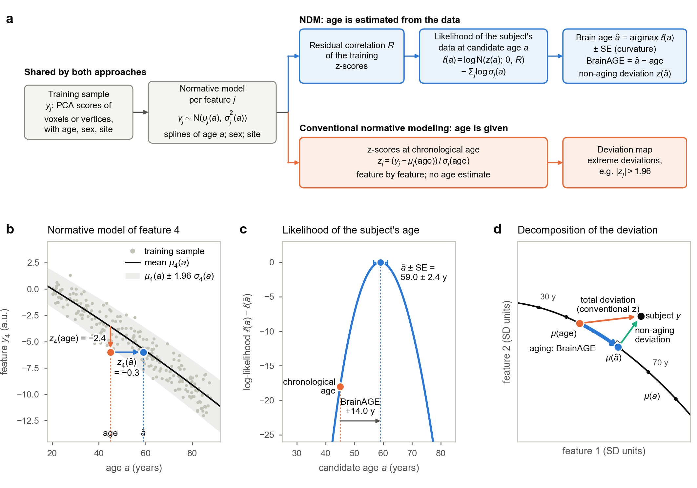

# Brain age from normative models (NDM): methods

> Draft methods section for the NDM brain age (NormBrainAGE) implemented in `neurogamlss.py` of NeuroGAMLSS. Values in square brackets are study-specific and need to be filled in. The notes at the end are for the authors and are not part of the manuscript text.


**Figure 1. Brain age from normative models (NDM) and conventional normative modeling.** (a) Both approaches fit a location–scale normative model to every feature of a training sample. Conventional normative modeling (orange) computes z-scores at chronological age and evaluates them feature by feature. NDM (blue) treats age as an unknown parameter of the same models. The brain age $`\hat a`$ is the age at which the subject's data are most likely, given the residual correlation $`\mathbf{R}`$ of the features. (b, c) Simulated example with 12 independent features ($`\mathbf{R} = \mathbf{I}`$) and one subject aged 45 years whose data were drawn at age 58 years, with additional non-aging deviations in two features. (b) Normative model of feature 4 with the training sample (dots), the mean (line) and the 95% range (band). At chronological age, the subject lies 2.4 SD below the mean (orange). At the brain age of 59.0 years, its value is typical (z = −0.3, blue). (c) Log-likelihood of age from all 12 features. Its maximum defines the brain age, and its curvature the standard error. (d) Schematic of two features with equal, age-independent SD and $`\mathbf{R} = \mathbf{I}`$. The normative mean $`\mu(a)`$ traces a trajectory through feature space as age increases (dots every 10 years). The conventional deviation of the subject (orange) mixes two parts: a shift along the trajectory, given by the BrainAGE (blue), and a non-aging deviation (aqua) that is orthogonal to the trajectory at $`\mu(\hat a)`$. A conventional deviation map therefore flags features that only reflect an older- or younger-appearing brain and can hide deviations that run against the aging direction. NDM separates the two parts.

## Overview

Normative models describe the distribution of a brain feature in a reference population as a function of age and other covariates (Marquand et al., 2016, 2019; Rutherford et al., 2022; Bethlehem et al., 2022). They are usually applied in the forward direction. An individual's data are standardized at the individual's chronological age, and the resulting z-scores, or deviation maps, indicate which features are atypical (Wolfers et al., 2018). Normative deviation mapping (NDM) uses the same models in the reverse direction (Fig. 1a). Age is treated as an unknown parameter of the normative model, and the brain age is the age at which an individual's data are most likely.

Reversing the direction of inference has three consequences. First, the estimate does not regress toward the mean age of the training sample. Regression-based brain age models such as Gaussian process regression (GPR) BrainAGE (Franke et al., 2010; Kalc et al., 2024) approximate the expected age given the image. Such estimates are shrunk toward the mean of the training ages and require a correction of the age bias (Le et al., 2018; Smith et al., 2019; de Lange and Cole, 2020). NDM instead maximizes the likelihood of the image given age, which is the classical estimator of statistical calibration (Eisenhart, 1939; Brown, 1982; Osborne, 1991). For a correctly specified and informative normative model with known parameters, this estimate is approximately unbiased conditional on chronological age. Where the age information is limited, and with normative models estimated from a finite training sample, a bias remains, which depends on the size and the age distribution of that sample; we quantified it instead of assuming it to be zero (see *Uncertainty of the estimate* and *Age bias in simulated data*). For independent features with linear age effects and constant variance, it reduces to the biological age estimator of Klemera and Doubal (2006) without their additional term for chronological age. Second, the likelihood yields an interval and a standard error for each individual estimate. Third, the deviation of an individual from the normative population splits into a shift along the normative aging trajectory, which is the BrainAGE, and a non-aging deviation that an older- or younger-appearing brain does not explain (Fig. 1d).

Inverting a model of the data given age is an established idea. In neuroimaging, Mauri et al. (2025) invert a voxel-wise generative model of the image given age and covariates, with a low-rank noise covariance, to predict age, and Smith et al. (2019) discuss the regression of imaging measures on age as the alternative direction, in which regression dilution does not arise. In the estimation of age at death from skeletal indicators, regressing age on the indicator makes the estimates mimic the age distribution of the reference sample (Bocquet-Appel and Masset, 1982; Aykroyd et al., 1997), and estimates from models of the indicator given age, by maximum likelihood or with an explicit prior, are the established remedy (Konigsberg et al., 1998; Boldsen et al., 2002). Likelihood-based epigenetic clocks follow the same principle (Trapp et al., 2021; Mboning et al., 2024). NDM applies it to the location–scale normative models of neuroimaging: with a variance that depends on age, the residual correlation of the features, and the same kind of model that yields deviation maps.

## Features

T1-weighted images were preprocessed with CAT12 (Gaser et al., 2024). As in our GPR-based workflow (Kalc et al., 2024), we used the affinely registered gray matter (GM) and white matter (WM) segmentations, resampled to [4 and 8] mm and smoothed with Gaussian kernels of [4 and 8] mm full width at half maximum. Each combination of tissue, resampling and smoothing defines one model. The [M] models were analyzed separately and combined at the end (see *Ensemble of models*). Vertex-wise surface measures such as cortical thickness can be used in the same way. When training samples from several studies were pooled, each study was treated as a site. Subjects without a valid age were excluded.

For each model, the voxel- or vertex-wise data of the training sample were reduced by principal component analysis (PCA). Voxels or vertices with non-finite values or zero variance in the training sample were removed. So were near-empty voxels, whose mean over the training subjects was below [0.05], and for surface data vertices whose mean was below [5%] of the median of all vertex means. The same mask was used for the deviation maps. Every voxel or vertex was centered with its training mean and divided by its training standard deviation, so that all of them entered the PCA with unit variance. The principal axes were obtained from the eigendecomposition of the $`n \times n`$ Gram matrix of the $`n`$ training subjects. The scores of the first $`K = \min(100, n-1)`$ components are the features $`y_j`$ ($`j = 1, \dots, K`$) of the normative models. Test data were standardized with the training means and standard deviations and projected onto the same axes. PCA does not use age and was repeated in every training set, that is, within every cross-validation fold.

## Location–scale normative models

For every feature $`j`$, we fitted a normal location–scale model in which both the mean and the standard deviation depend on age (Fig. 1b):

```math
y_{ij} \sim \mathcal{N}(\mu_j(a_i, s_i, c_i),\ \sigma_j^2(a_i, s_i)),
\qquad (1)
```

```math
\begin{aligned}
\mu_j(a, s, c) &= \beta_{0j} + \mathbf{b}_\mu(a)^\top \boldsymbol{\beta}_j + \beta_{sj}\, s + \gamma_{cj},
\\ \log\, \sigma_j(a, s) &= \theta_{0j} + \mathbf{b}_\sigma(a)^\top \boldsymbol{\theta}_j + \theta_{sj}\, s .
\end{aligned}
\qquad (2)
```

Here, $`a_i`$ is the age of subject $`i`$, $`s_i`$ its sex (1 for males, 0 for females) and $`c_i`$ its site, with $`\gamma_{1j} = 0`$. The age effects $`\mathbf{b}_\mu(a)`$ and $`\mathbf{b}_\sigma(a)`$ are natural cubic spline bases without intercept (Hastie et al., 2009) with [3] and [1] degrees of freedom. The degrees of freedom were chosen for each model by 5-fold cross-validation within the training sample, with folds stratified by site and age. Those of $`\mu`$ were chosen from 1 to 8 with 3 for $`\sigma`$, and then those of $`\sigma`$ from 1 to 4, by the mean absolute error of the held-out brain age after removing its median. Because a brain age that is shrunk toward the middle of the age range can have a smaller error than an unbiased one, we also recorded, for every setting, the slope of the held-out BrainAGE on age [report the slope of the chosen setting]. Their boundary knots lie at the 5th and 95th percentiles of the training ages and their inner knots at equally spaced quantiles between them, as in restricted cubic splines (Harrell, 2015). The trajectories are linear below and above the boundary knots, so that single very young or very old subjects do not bend them, and they continue linearly outside the training range. Sex enters the mean and the log standard deviation as a main effect. It is omitted when the training sample contains only one sex or when sex is unknown for the test data. Site enters the mean as a fixed effect. For prediction, the site effect is replaced by its average over the training sites weighted by their sample sizes, $`\bar\gamma_j = \sum_c \pi_c \gamma_{cj}`$, analogous to the standardized mean of ComBat (Johnson et al., 2007). We refer to this as the reference site.

The parameters were estimated by maximum likelihood with the RS algorithm of generalized additive models for location, scale and shape (Rigby and Stasinopoulos, 2005), following its implementation in ComBatLS (Gardner et al., 2024). Starting from ordinary least squares and a constant standard deviation, the algorithm alternates between a weighted least-squares update of the mean parameters, with weights $`\sigma^{-2}`$, and a Fisher scoring step for the parameters of $`\log\, \sigma`$. For the normal distribution, this step is the least-squares regression of $`(z^2 - 1)/2`$ on the design of $`\log\, \sigma`$. It is halved, up to 20 times, if the deviance increases. Iterations stopped when the changes of $`\mu`$, in units of $`\sigma`$, and of the $`\log\, \sigma`$ parameters fell below $`10^{-6}`$, or after 2000 iterations. All features were fitted simultaneously in vectorized form.

The z-scores relative to the normative model at age $`a`$ are

```math
z_j(a) = \frac{y_j - \mu_j(a, s)}{\sigma_j(a, s)},
\qquad (3)
```

where $`\mu_j(a, s)`$ refers to the reference site. Conventional normative modeling evaluates (3) at the chronological age (Fig. 1a, orange). NDM treats $`a`$ as unknown (Fig. 1a, blue).

## Residual correlation

PCA scores are uncorrelated in the training sample, but their z-scores are not. Removing the effects of age, sex and site, and scaling each score by its own age-dependent standard deviation, induces correlations between them. We therefore modeled the z-scores of an individual as multivariate normal, $`\mathbf{z} \sim \mathcal{N}(\mathbf{0}, \mathbf{R})`$, and estimated $`\mathbf{R}`$ from the z-scores $`\mathbf{z}_i`$ of the training subjects at their own age, sex and site:

```math
\mathbf{R} = \frac{1}{n} \sum_{i=1}^{n} \mathbf{z}_i \mathbf{z}_i^\top + \psi\, \mathbf{I}, \qquad \psi = 0.01 .
\qquad (4)
```

At the maximum likelihood solution, the mean of $`z_{ij}^2`$ over the training subjects is exactly one, so the first term has a unit diagonal. The small ridge $`\psi`$ stabilizes the inverse.

## Brain age as the most likely age

Under (1)–(4), the log-likelihood of the features $`\mathbf{y}`$ of a test subject at a candidate age $`a`$ is

```math
\ell(a) = \log\, p(\mathbf{y} \mid a, s) = -\frac{1}{2}\, \mathbf{z}(a)^\top \mathbf{R}^{-1} \mathbf{z}(a) - \sum_{j=1}^{K} \log\, \sigma_j(a, s) + \text{const},
\qquad (5)
```

where the constant does not depend on $`a`$. The second term is the Jacobian of the standardization. Without it, the estimate would favor ages at which the normative distribution is wide. The brain age is the maximum likelihood estimate, and BrainAGE is its difference from chronological age (Fig. 1c):

```math
\hat a = \underset{a}{\arg\max}\ \ell(a), \qquad \mathrm{BrainAGE} = \hat a - a_{\mathrm{chron}} .
\qquad (6)
```

The likelihood uses the normative model of the subject's sex at the reference site. This also applies to test subjects from a training site. We evaluated $`\ell`$ on a grid of ages in steps of 0.25 years, from 5 years below the youngest to 5 years above the oldest training subject, but not below zero. The maximum was refined by a parabola through the grid maximum and its two neighbors. Because the whole grid is searched, the global maximum is found even if $`\ell`$ has several local maxima. Estimates at the end of the grid were flagged.

The estimate maximizes $`p(\mathbf{y} \mid a)`$ and involves no prior distribution of age. It therefore depends on the training sample only through the fitted normative models. This does not make it independent of the training age distribution: the models are estimated least precisely where training subjects are few, and the trajectories are linear beyond the boundary knots. Near the limits of the training age range, the truncation of the grid adds to this. [We did not apply an age-bias (trend) correction; see the author notes.]

## Uncertainty of the estimate

**Likelihood-ratio interval.** The 95% interval of each estimate contains all ages that the data do not reject against the maximum in a likelihood-ratio test,

```math
\{\, a : \ell(\hat a) - \ell(a) \le \tfrac{1}{2}\, \chi^2_{1;\,0.95} = 1.92 \,\},
```

read from the grid, with the limits interpolated linearly between grid points. Unlike a symmetric interval around $`\hat a`$, it follows the shape of the likelihood and is therefore asymmetric where the trajectories flatten on one side. If $`\ell`$ has several maxima, the set consists of several intervals; we report its smallest and largest age and the number of intervals. An interval that reaches an end of the grid is flagged as open, because its limit there is the end of the grid and not a bound. We assessed the calibration by the proportion of control subjects whose chronological age lies within the interval of their brain age.

**Standard error.** For comparison with other methods, we also report the standard error from the curvature of the log-likelihood at its maximum (Laplace approximation):

```math
\mathrm{SE}(\hat a) = (-\ell''(\hat a))^{-1/2},
\qquad (7)
```

with $`\ell''`$ obtained from the second difference of $`\ell`$ on the grid. This is the standard error of the maximum likelihood estimate based on the observed information.

**Bias and precision along age.** The maximum likelihood estimate is unbiased only asymptotically, that is, where the data carry much information about age. Where the trajectories are flat, the estimate is not normally distributed around the true age; and the grid ends 5 years beyond the training range, and the trajectories are linear beyond the boundary knots, which pulls estimates near the limits of the age range toward its interior. We quantified both by a parametric bootstrap, which asks what the estimate does if the fitted model is exactly true. For every age $`a`$ on a grid of 2 years and for both sexes, we drew the features of [200] hypothetical subjects of that age from the fitted model, $`\mathbf{y}^* = \boldsymbol\mu(a) + \boldsymbol\sigma(a) \circ \mathbf{z}^*`$ with $`\mathbf{z}^* \sim \mathcal{N}(\mathbf{0}, \mathbf{R})`$ and the element-wise product $`\circ`$, and estimated their brain ages $`\hat a^*`$ as for a subject. The draws were antithetic pairs $`(\mathbf{z}^*, -\mathbf{z}^*)`$ and the same for all ages. The bias at age $`a`$ is

```math
b(a) = \mathrm{E}\,[\hat a^* \mid a] - a ,
```

the standard deviation of $`\hat a^*`$ is the actual standard error at that age, and the proportion of the intervals that contain $`a`$ is their coverage. No data of real subjects enter. For a real subject, the true age of the brain is unknown, but for a subject whose brain is typical of its chronological age $`a_c`$, the expected BrainAGE is $`b(a_c)`$. Like the fitted trend of a trend correction, $`b(a_c)`$ is a function of the chronological age, but it follows from the model and not from the BrainAGE of control subjects. [State whether $`b(a_c)`$ was subtracted from BrainAGE; see the author notes.] The bootstrap treats the normative models as known. It does not show the bias that follows from their estimation and from the PCA, which we studied by simulation (see *Age bias in simulated data*).

## Aging and non-aging deviation

Let $`\mathbf{v}(a)`$ denote the standardized aging direction with components $`v_j(a) = \mu_j'(a, s) / \sigma_j(a, s)`$. If $`\sigma`$ does not depend on age, the condition $`\ell'(\hat a) = 0`$ becomes

```math
\mathbf{z}(\hat a)^\top \mathbf{R}^{-1} \mathbf{v}(\hat a) = 0 .
```

The z-scores at brain age are thus orthogonal to the aging direction in the metric $`\mathbf{R}^{-1}`$. The conventional z-scores at chronological age decompose exactly into

```math
\mathbf{z}(a_{\mathrm{chron}}) =
\underset{\text{aging}}{\frac{\boldsymbol{\mu}(\hat a) - \boldsymbol{\mu}(a_{\mathrm{chron}})}{\boldsymbol{\sigma}}}
+ \underset{\text{non-aging}}{\mathbf{z}(\hat a)},
\qquad (8)
```

with element-wise division. The first term is a displacement along the normative trajectory and is determined by chronological age and BrainAGE. The second term is the part of the deviation that an older- or younger-appearing brain does not explain (Fig. 1d). With age-dependent $`\sigma`$, the decomposition holds approximately.

We summarized each deviation by the squared Mahalanobis distance $`d^2(a) = \mathbf{z}(a)^\top \mathbf{R}^{-1} \mathbf{z}(a)`$. If the model holds, it follows a $`\chi^2`$ distribution with $`K`$ degrees of freedom at the true age. We transformed it into a normal score with the approximation of Wilson and Hilferty (1931):

```math
\mathrm{Dev}(a) = \frac{(d^2(a)/K)^{1/3} - (1 - 2/(9K))}{\sqrt{2/(9K)}} .
\qquad (9)
```

We report the non-aging deviation $`\mathrm{Dev}(\hat a)`$ and the total deviation $`\mathrm{Dev}(a_{\mathrm{chron}})`$. Positive values indicate data that are less typical of the normative population than average.

## Tissue loss beyond aging

The non-aging deviation measures atypicality in any direction. To measure tissue loss that an older- or younger-appearing brain does not explain, we computed for every subject the mean $`\bar y`$ of the voxel or vertex values of the whole brain and of each lobe, in the units of the data. In the training sample, this mean was modeled with a normal location–scale model with the terms of (2), whose degrees of freedom were chosen by 5-fold cross-validation of the held-out likelihood. BrainLOSS (Loss Of Substance beyond Senescence) is minus the z-score of the mean at the subject's brain age at the reference site, $`\mathrm{BrainLOSS} = -(\bar y - \mu(\hat a))/\sigma(\hat a)`$, so that positive values indicate less tissue than expected for the brain age. Regional values use the brain age of the whole brain. We also report the same score at the chronological age, $`\mathrm{BrainLOSS}_{\mathrm{age}} = -(\bar y - \mu(a_{\mathrm{chron}}))/\sigma(a_{\mathrm{chron}})`$, which measures the total tissue loss for the subject's age. When control subjects of the test site were available, both scores were standardized to mean 0 and standard deviation 1 in the controls, with the offsets of several scanners shrunk as described in *Adaptation to new sites*. Because it is evaluated at the brain age, BrainLOSS is approximately unrelated to the aging pattern and complements BrainAGE. For a linear trajectory and a constant standard deviation, the two scores before standardization differ by the part of the deficit that the brain age explains, $`\mathrm{BrainLOSS}_{\mathrm{age}} = \mathrm{BrainLOSS} + b\, \mathrm{BrainAGE}`$, where $`b = -\mu'/\sigma`$ is the normative decline of the mean per year in standard deviations. $`\mathrm{BrainLOSS}_{\mathrm{age}}`$ therefore overlaps with BrainAGE.

## Regional brain age

For regional estimates, we used the lobe atlas of Toro et al. (2009). It contains the frontal, parietal, occipital and temporal lobes and a subcortical/cerebellar region in each hemisphere. The subcortical/cerebellar regions were not used for surface data. PCA, normative models, residual correlation and likelihood were computed separately from the voxels or vertices of each region. This yields a regional brain age with its standard error and regional deviations for every subject.

## Ensemble of models

The brain ages $`\hat a_m`$ of the $`M`$ models were combined by a weighted average, $`\hat a_{\mathrm{ens}} = \sum_m w_m \hat a_m`$, with weights that sum to one. Because the estimates of all models are approximately unbiased conditional on age, so is any such average. By default, the weights minimize the mean squared error of the combination under the sum-to-one constraint (Bates and Granger, 1969):

```math
\mathbf{w} = \frac{\mathbf{C}^{-1} \mathbf{1}}{\mathbf{1}^\top \mathbf{C}^{-1} \mathbf{1}},
\qquad
C_{mm'} = \frac{1}{n_c} \sum_{i=1}^{n_c} e_{im}\, e_{im'},
\qquad (10)
```

where $`e_{im}`$ is the BrainAGE of control subject $`i`$ in model $`m`$ and $`n_c`$ the number of control subjects. These weights account for the correlation of the errors between models and can be negative. Equal weights and weights proportional to the inverse squared mean absolute error, as in the GPR workflow, are available as alternatives. Regional brain ages were combined in the same way for each region. The deviation of the ensemble is the mean of the normal scores of the models.

## Adaptation to new sites

When the test data came from scanners or sites that were not part of the training data, we used healthy control subjects of the test site. By default, the median BrainAGE of these controls was subtracted from the estimates of all test subjects. No trend correction was applied. A linear trend correction as in the GPR workflow is available but was not used.

Two alternatives adapt the normative models instead. The first estimates, for every feature, the mean $`o_j`$ and the standard deviation $`r_j`$ of the controls' z-scores at their chronological ages and replaces the normative model by

```math
\tilde\mu_j(a, s) = \mu_j(a, s) + o_j\, \sigma_j(a, s),
\qquad
\tilde\sigma_j(a, s) = r_j\, \sigma_j(a, s) .
\qquad (11)
```

This corresponds to the location and scale step of ComBat (Johnson et al., 2007; Fortin et al., 2018) without empirical Bayes shrinkage. The second alternative does not require the controls' ages. It alternates between estimating the controls' brain ages with the current adaptation and re-estimating (11) at these brain ages. It stops when the brain ages change by less than 0.01 years, or after 20 iterations. Without ages, a site effect along the aging trajectory cannot be distinguished from a shift of brain age. The remaining offset is therefore removed with the controls' median BrainAGE. In all cases, the control subjects were also used to estimate the ensemble weights.

When the test data came from several scanners, every scanner was adapted with its own controls. The median BrainAGE of the controls of each scanner was subtracted from the estimates of its subjects. In (11), the mean $`m_{sj}`$ of the $`n_s`$ controls of scanner $`s`$ was shrunk toward the mean $`m_j`$ of all controls, $`o_{sj} = m_j + \lambda_{sj} (m_{sj} - m_j)`$ with $`\lambda_{sj} = \tau_j^2 / (\tau_j^2 + \sigma_j^2 / n_s)`$, where $`\sigma_j^2`$ and $`\tau_j^2`$ are the variances within and between the scanners, estimated by the method of moments of the one-way analysis of variance (random scanner intercepts). All scanners shared one scale $`r_j`$, the standard deviation of the controls around the offsets of their scanners with $`n_c - \mathrm{edf}_j`$ degrees of freedom, where $`\mathrm{edf}_j = 1 + \sum_s \lambda_{sj} (1 - n_s / n_c)`$.

## Non-Gaussian features (optional)

For brain age, skewed or heavy-tailed data can be transformed voxel- or vertex-wise before all other steps with a sinh–arcsinh warp (Jones and Pewsey, 2009),

```math
w = \sinh(\delta\, \mathrm{asinh}(x) - \varepsilon),
\qquad (12)
```

where $`x`$ is the standardized value. As in warped Bayesian linear regression (Fraza et al., 2021), the warp parameters $`(\varepsilon, \delta)`$ and the location–scale model (1)–(2) of the warped data were estimated jointly. We maximized the likelihood of the original data, including the Jacobian of the warp, with weak normal priors of variance 9 on $`\varepsilon`$ and $`\log\, \delta`$ that are centered on the identity warp. The optimization uses block-coordinate ascent. Damped Newton steps update $`(\varepsilon, \log\, \delta)`$ for a fixed location and scale, bounded to $`|\varepsilon| \le 5`$ and $`0.1 \le \delta \le 10`$. A closed-form affine rescaling then carries the location and scale over to the new warp, followed by three warm-started iterations of the RS algorithm. Only steps that increased the likelihood were accepted. Iterations stopped when the gain fell below $`10^{-5}`$ per subject, or after 40 rounds. The warp does not depend on age, so its Jacobian is constant in (5), and the warped data replace the original data in all later steps.

## Voxel- and vertex-wise deviation maps

To localize deviations, we also computed conventional deviation maps (Fig. 1a, orange). Voxel- and vertex-wise data are often skewed or heavy-tailed. We therefore fitted a GAMLSS with the sinh–arcsinh distribution (Jones and Pewsey, 2009) to every voxel or vertex of the training data instead of the normal model (1). In the SHASHo2 parameterization of gamlss.dist (Rigby et al., 2019), $`\sinh(\tau\, \mathrm{asinh}(z) - \nu)`$ follows a standard normal distribution, with $`z = (y - \mu)/(\sigma\tau)`$. The location $`\mu`$ and the log scale $`\log\, \sigma`$ depend on age, sex, site and covariates as in (2). The skewness $`\nu`$ and the tail weight $`\tau`$ are constant for each voxel or vertex. With $`\nu = 0`$ and $`\tau = 1`$, the model reduces to (1). Normal priors with standard deviation 1 on $`\nu`$ and $`\log\, \tau`$ shrink the shape toward the normal distribution, and $`\tau`$ was kept between 0.2 and 2. The fit started from the normal model and continued with damped Newton steps using exact derivatives, with the absolute eigenvalues of the Hessian where it was indefinite (Nocedal and Wright, 2006). The deviation map is the normal score $`\sinh(\tau\, \mathrm{asinh}(z) - \nu)`$ at chronological age, which equals (3) for the normal model. When control subjects were available, the controls' normal scores were standardized to mean 0 and standard deviation 1, which is equivalent to (11) for the normal model; with several scanners, their offsets were shrunk as described above. This used the controls' chronological ages, or their brain ages for the age-free adaptation. The degrees of freedom of $`\mu`$ and $`\sigma`$ were the same for all voxels or vertices and were chosen by 5-fold cross-validation of normal models of 1,000 random voxels or vertices: first those of $`\mu`$ from 2 to 12 with 3 for $`\sigma`$, then those of $`\sigma`$ from 1 to 5. The criterion was the median over voxels of the held-out log-likelihood, which is robust to the few near-empty voxels in which flexible curves fail. With the lobe atlas, the maps were also averaged within regions. The calibration of the voxel- and vertex-wise models was checked in [10] age groups of the training sample with Q statistics (Royston and Wright, 2000) and worm plots (van Buuren and Fredriks, 2001).

## Voxel-wise variant

Normative models can also be fitted directly to every voxel or vertex instead of to PCA scores. The full residual correlation then cannot be estimated from the training sample. We approximated it by a low-rank plus diagonal model, $`\mathbf{R} = \mathbf{V} \boldsymbol{\Lambda} \mathbf{V}^\top + \boldsymbol{\Psi}`$. Here, $`\mathbf{V}`$ and $`\boldsymbol{\Lambda}`$ contain the leading [20] eigenvectors and eigenvalues of the training z-scores, and $`\Psi_{jj} = \max(1 - \sum_k \lambda_k V_{jk}^2,\ \psi)`$. $`\mathbf{R}^{-1}`$ was applied with the Woodbury identity. Rank zero treats the features as independent. [Results of this variant: Supplementary Material.]

## Comparison method and evaluation

We compared NDM with GPR BrainAGE (Kalc et al., 2024) on the same data and folds. The training data were centered, divided by their range and reduced by PCA with $`n-1`$ components, whose scores were rescaled to $`[0, 1]`$. A GPR with a linear covariance function, a constant prior mean of 100 years and a fixed noise standard deviation of $`e^{-1}`$ was then followed by a linear age-bias correction estimated in the control subjects.

Within a dataset, accuracy was assessed with [10]-fold cross-validation. Folds were stratified by age: subjects were sorted by age, with ties broken at random, and assigned to the folds in turn. All steps of NDM, including PCA, normative models and residual correlation, were estimated in the training folds only. We report the mean absolute error (MAE), the root mean squared error and the correlation of brain age with chronological age. As measures of the residual age bias, we report the correlation of BrainAGE with chronological age, the slope of its regression on age and its mean in [deciles] of age. We also report the mean BrainAGE and the coverage of the 95% likelihood-ratio intervals.

## Age bias in simulated data

The true brain age of real subjects is unknown, so real data cannot show whether BrainAGE depends on age for reasons of the method. We therefore simulated data at known ages, so that the true BrainAGE of every subject was 0, and passed them through the whole pipeline, including PCA and the choice of the degrees of freedom. The simulated data consisted of 3,000 features whose means followed three spatial patterns with different age trajectories. Subjects differed by 600 latent spatial factors with a power-law spectrum, whose size grew with age by 15%, by a sex effect and by white noise. In one setting, the trajectories changed at every age; in the other, the main trajectory was an inverted U with its maximum at 46 years, so that mid-adulthood carried little age information. Training samples of 300, 1,000 and 3,000 subjects aged 18 to 88 years were drawn with five age distributions (uniform, mostly young, mostly old, bimodal, and 55 ± 10 years), with [five] samples per condition. Each was evaluated on an independent sample of 4,000 subjects with uniform ages, out of fold and in-sample. We report the slope of BrainAGE on age and its mean in deciles of age, for NDM and for GPR BrainAGE with and without the linear trend correction.

With 1,000 training subjects and uniform training ages, the slope of the uncorrected NDM BrainAGE in the independent sample was [−0.07] years per year ([−0.09] with the inverted-U trajectory), against [−0.24] ([−0.39]) for the uncorrected GPR. It was [−0.12] with 300 and [−0.03] with 3,000 training subjects, and between [−0.05] and [−0.18] ([−0.06] and [−0.35]) for the other training age distributions, largest where the test ages reached beyond the ages that the training sample covered well. In the training subjects themselves, the slope was at most [−0.02] ([−0.08]), so the age bias is not visible in the training fit. To separate its sources, we replaced the principal axes, the normative models with the residual correlation, or both by those of 12,000 subjects. With both replaced, a slope of [−0.02 to −0.04] ([−0.06]) remained, which is the bias of the maximum likelihood estimate with limited age information and does not depend on the training size. The estimation error of the normative models added [−0.10] ([−0.23]) with 300 and [−0.02] ([−0.06]) with 1,000 training subjects, and that of the principal axes had no clear effect. The component scores of the training subjects, which took part in the PCA, were more dispersed than those of new subjects; this shifted the brain age of new subjects by [1 to 2] years toward younger ages and changed the slope by up to [0.03] in either direction with 1,000 training subjects. After the same linear trend correction of both methods, the root mean square of the mean BrainAGE over the age deciles was [0.4 to 1.0] years for NDM and [0.6 to 2.7] years for GPR with trajectories that changed at every age, and [2.1 to 5.5] and [2.5 to 5.7] years with the inverted-U trajectory. A true difference in brain age is attenuated by a method whose BrainAGE falls with age: of a difference of 8 years between subjects of the same chronological ages, NDM recovered [82% to 98%] ([56%] and [69%] with the inverted-U trajectory and training ages that did not cover the test ages) and GPR [26% to 82%]; additive corrections do not change this share.

## Implementation

NDM is implemented in Python with NumPy and SciPy, using h5py for MATLAB v7.3 files and nibabel for surface atlases. It is available as NormBrainAGE in `neurogamlss.py` of NeuroGAMLSS (https://github.com/ChristianGaser/NeuroGAMLSS), which also fits the voxel- and vertex-wise normative models. The script reads the data files written by `BA_data2mat` and saves the results in MATLAB and CSV format. Because $`\mathbf{R}`$ does not depend on age, the quadratic form in (5) can be expanded, so that $`\ell`$ for all subjects of one sex and all grid ages is obtained with a few matrix products. [Computation times.]

## References

- Aykroyd, R.G., Lucy, D., Pollard, A.M., Solheim, T., 1997. Technical note: regression analysis in adult age estimation. American Journal of Physical Anthropology 104, 259–265. [verify]
- Bates, J.M., Granger, C.W.J., 1969. The combination of forecasts. Operational Research Quarterly 20, 451–468.
- Bethlehem, R.A.I., Seidlitz, J., White, S.R., et al., 2022. Brain charts for the human lifespan. Nature 604, 525–533.
- Bocquet-Appel, J.-P., Masset, C., 1982. Farewell to paleodemography. Journal of Human Evolution 11, 321–333. [verify]
- Boldsen, J.L., Milner, G.R., Konigsberg, L.W., Wood, J.W., 2002. Transition analysis: a new method for estimating age from skeletons. In: Hoppa, R.D., Vaupel, J.W. (Eds.), Paleodemography: Age Distributions from Skeletal Samples. Cambridge University Press, Cambridge, pp. 73–106. [verify]
- Brown, P.J., 1982. Multivariate calibration. Journal of the Royal Statistical Society, Series B 44, 287–321.
- de Lange, A.-M.G., Cole, J.H., 2020. Commentary: Correction procedures in brain-age prediction. NeuroImage: Clinical 26, 102229.
- Eisenhart, C., 1939. The interpretation of certain regression methods and their use in biological and industrial research. Annals of Mathematical Statistics 10, 162–186.
- Fortin, J.-P., Cullen, N., Sheline, Y.I., et al., 2018. Harmonization of cortical thickness measurements across scanners and sites. NeuroImage 167, 104–120.
- Franke, K., Ziegler, G., Klöppel, S., Gaser, C., Alzheimer's Disease Neuroimaging Initiative, 2010. Estimating the age of healthy subjects from T1-weighted MRI scans using kernel methods: exploring the influence of various parameters. NeuroImage 50, 883–892.
- Fraza, C.J., Dinga, R., Beckmann, C.F., Marquand, A.F., 2021. Warped Bayesian linear regression for normative modelling of big data. NeuroImage 245, 118715.
- Gardner, M., Shinohara, R.T., Bethlehem, R.A.I., et al., 2024. ComBatLS: a location- and scale-preserving method for multi-site image harmonization. bioRxiv. [verify final publication]
- Gaser, C., Dahnke, R., Thompson, P.M., Kurth, F., Luders, E., Alzheimer's Disease Neuroimaging Initiative, 2024. CAT: a computational anatomy toolbox for the analysis of structural MRI data. GigaScience 13, giae049.
- Harrell, F.E., 2015. Regression Modeling Strategies, 2nd ed. Springer, Cham.
- Hastie, T., Tibshirani, R., Friedman, J., 2009. The Elements of Statistical Learning, 2nd ed. Springer, New York.
- Johnson, W.E., Li, C., Rabinovic, A., 2007. Adjusting batch effects in microarray expression data using empirical Bayes methods. Biostatistics 8, 118–127.
- Jones, M.C., Pewsey, A., 2009. Sinh-arcsinh distributions. Biometrika 96, 761–780.
- Kalc, P., Dahnke, R., Hoffstaedter, F., Gaser, C., Alzheimer's Disease Neuroimaging Initiative, 2024. BrainAGE: Revisited and reframed machine learning workflow. Human Brain Mapping 45, e26632.
- Klemera, P., Doubal, S., 2006. A new approach to the concept and computation of biological age. Mechanisms of Ageing and Development 127, 240–248.
- Konigsberg, L.W., Hens, S.M., Jantz, L.M., Jungers, W.L., 1998. Stature estimation and calibration: Bayesian and maximum likelihood perspectives in physical anthropology. Yearbook of Physical Anthropology 41, 65–92. [verify]
- Le, T.T., Kuplicki, R.T., McKinney, B.A., et al., 2018. A nonlinear simulation framework supports adjusting for age when analyzing BrainAGE. Frontiers in Aging Neuroscience 10, 317.
- Marquand, A.F., Rezek, I., Buitelaar, J., Beckmann, C.F., 2016. Understanding heterogeneity in clinical cohorts using normative models: beyond case-control studies. Biological Psychiatry 80, 552–561.
- Marquand, A.F., Kia, S.M., Zabihi, M., Wolfers, T., Buitelaar, J.K., Beckmann, C.F., 2019. Conceptualizing mental disorders as deviations from normative functioning. Molecular Psychiatry 24, 1415–1424.
- Mauri, C., Cerri, S., Puonti, O., Mühlau, M., Van Leemput, K., 2025. A lightweight generative model for interpretable subject-level prediction. Medical Image Analysis 101, 103436. [verify the description of the method in the full text]
- Mboning, L., Rubbi, L., Thompson, M., Bouchard, L.-S., Pellegrini, M., 2024. BayesAge: a maximum likelihood algorithm to predict epigenetic age. Frontiers in Bioinformatics 4, 1329144. [verify]
- Nocedal, J., Wright, S.J., 2006. Numerical Optimization, 2nd ed. Springer, New York.
- Osborne, C., 1991. Statistical calibration: a review. International Statistical Review 59, 309–336.
- Rigby, R.A., Stasinopoulos, D.M., 2005. Generalized additive models for location, scale and shape. Journal of the Royal Statistical Society, Series C 54, 507–554.
- Rigby, R.A., Stasinopoulos, D.M., Heller, G.Z., De Bastiani, F., 2019. Distributions for Modeling Location, Scale, and Shape: Using GAMLSS in R. Chapman and Hall/CRC, Boca Raton.
- Royston, P., Wright, E.M., 2000. Goodness-of-fit statistics for age-specific reference intervals. Statistics in Medicine 19, 2943–2962.
- Rutherford, S., Kia, S.M., Wolfers, T., et al., 2022. The normative modeling framework for computational psychiatry. Nature Protocols 17, 1711–1734.
- Smith, S.M., Vidaurre, D., Alfaro-Almagro, F., Nichols, T.E., Miller, K.L., 2019. Estimation of brain age delta from brain imaging. NeuroImage 200, 528–539.
- Toro, R., Chupin, M., Garnero, L., et al., 2009. Brain volumes and Val66Met polymorphism of the BDNF gene: local or global effects? Brain Structure and Function 213, 501–509.
- Trapp, A., Kerepesi, C., Gladyshev, V.N., 2021. Profiling epigenetic age in single cells. Nature Aging 1, 1189–1201. [verify]
- van Buuren, S., Fredriks, M., 2001. Worm plot: a simple diagnostic device for modelling growth reference curves. Statistics in Medicine 20, 1259–1277.
- Wilson, E.B., Hilferty, M.M., 1931. The distribution of chi-square. Proceedings of the National Academy of Sciences 17, 684–688.
- Wolfers, T., Doan, N.T., Kaufmann, T., et al., 2018. Mapping the heterogeneous phenotype of schizophrenia and bipolar disorder using normative models. JAMA Psychiatry 75, 1146–1155.

<!--
- **Claim of unbiasedness.** Earlier drafts stated that NDM is approximately unbiased conditional on age and needs no age-bias correction. The simulation does not support this (docs/models.md, Age bias in simulated data): a slope of −0.02 to −0.06 remained even with models of 12,000 subjects, and with training samples of realistic size the slope of the uncorrected BrainAGE on age in new subjects was −0.03 to −0.12 with uniform training ages and up to −0.35 with skewed ones, 14% to 55% of that of the uncorrected GPR. The defensible claim is a much smaller age bias than regression without correction, and a smaller or equal remaining bias after the same trend correction. Report the out-of-fold slope and the decile means of the study data. The numbers in *Age bias in simulated data* come from 3 to 5 training samples per condition; rerun `scripts/simulate_brainage.py` with more samples (`--reps`) for the paper.
- **PCA and the number of components.** In the simulation, the estimation error of the principal axes did not matter, but the training scores are more dispersed than those of new subjects (variance of the z-scores of new subjects 0.75, 0.90 and 0.96 with 300, 1,000 and 3,000 training subjects). This offsets the opposite error of the estimated residual correlation, so models of cross-fitted scores are not a remedy: with 300 subjects they raised the error by 1.0 to 1.6 years. More components lowered the error and the coverage of the intervals (0.94 with 25, 0.88 with 200 components and 1,000 subjects) and, with trajectories that change at every age, raised the age bias (slope −0.05 to −0.09). Report the mean BrainAGE, the slope and the coverage of the study data for the number of components used, not only the error. Without PCA, the age bias was larger and the intervals covered about 20%.
- **Trend correction.** Decide whether to apply it (`--correction trend`). Without it, the methods text must state the size of the remaining slope; with it, NDM loses the argument that no correction is needed, but in the simulation its remaining bias was still smaller than or equal to that of GPR. The simulation was not built to compare accuracy: after the correction, GPR had the smaller error with skewed training ages.
- **In-sample fit.** Never report the age bias or the error of the training subjects: in the simulation their slope was near 0 and their error 13% to 24% smaller than out of fold. For test ages outside the training age distribution, the out-of-fold slope understates the bias as well.
- **Prior work.** The paragraph on prior work and its six new references were checked only in search-result extracts of the publishers' pages; the full texts could not be opened from the session that wrote this. Before submission, read Mauri et al. (2025; a generative model of the image given age, inverted by Bayes' rule, as far as the extracts show with a flat prior, a low-rank noise covariance and a variance that does not depend on age) and the section "Switching predictor matrix and age" of Smith et al. (2019). Also check Brown et al. (2012, Current Biology 22, 1693–1698), which may estimate age by the Mahalanobis distance to age-dependent expected values (not confirmed), Dean et al. (2015, Human Brain Mapping 36, 1233–1244), who invert voxel-wise growth curves of myelin water fraction, and Stull et al. (2023, Royal Society Open Science 10, 220963), whose mixed cumulative probit has age-dependent mean and noise. No paper was found that estimates brain age by maximum likelihood from feature-wise location–scale normative models of MRI data; not having found one is no proof. Do not claim that NDM is the first method to invert a generative model for brain age, or that a likelihood-based standard error is new.
- **Criterion of the degrees of freedom.** A choice by the held-out log-likelihood of the scores was tried in the simulation and removed: it gave the same slope in most conditions and a larger error with small samples. The choice by the error of the brain age remains, and the search lists the slope of the held-out BrainAGE of every setting.
- **Bias by bootstrap and corrections without controls.** The parametric bootstrap (`--bias-replicates`) treats the fitted models as true. Its bias $`b(a)`$ is a function of the true age of the brain; the code writes it at the chronological age $`a_c`$ of every subject (`BrainAGE_bias`) and at its brain age (`PredictedAge_bias`) and subtracts neither. In the simulation, subtracting $`b(a_c)`$ reduced the age bias in every condition without raising the error (most with the inverted-U trajectory, by 37% to 56%), $`b(\hat a)`$ raised the error, and the linear trend of the out-of-fold BrainAGE of the training sample removed most of the rest where the training sample covered the test ages. None of them is validated on real data: the bootstrap bias is only as good as the normative model. Decide which, if any, to apply, and state it in the methods text. Leakage: $`b`$ is not fitted to test data, but a predicted age corrected with $`b(a_c)`$ uses the chronological age, so report the accuracy of the prediction without it; for BrainAGE in group comparisons it is an adjustment for age. $`b(\hat a)`$ uses the image alone.
- **Fisher information.** The expected information about age was reported in an earlier version and removed: with non-monotone trajectories, the standard error that it implies was far smaller than the actual one (3.8 against 6.7 years in the simulation), because the likelihood has a second maximum. The standard deviation of the bootstrap replaces it.
- **Coverage.** The likelihood-ratio intervals covered 81% to 92% in the simulation with 1,000 training subjects (Laplace: 73% to 90%) and 93% to 94% with 3,000 subjects of uniform ages. They do not include the estimation error of the normative models.
- **BrainLOSS.** Evidence so far comes from one sample: ADNI with CAT12 r1840 data, 130 pMCI against 128 sMCI (docs/models.md, BrainLOSS). The AUC was 0.60 for gray matter of the whole brain and 0.66 for the temporal lobes, against 0.72 for BrainAGE; white matter carried no information. Added to BrainAGE, the gain (0.716 to 0.742 with the temporal lobes) was not significant. Cross-validation chose 3 df for the mean model; 2 df gave 0.63. Confirm with CAT12.9 data and a larger sample before claiming added value.
- **BrainLOSS at chronological age.** `BrainLOSS_age` was added after the ADNI comparison and has not been evaluated. By the relation in *Tissue loss beyond aging*, it should add little to a model that already contains BrainAGE and BrainLOSS.
- **Standardization before the PCA.** It lowered the MAE in all 12 comparisons of gray and white matter at 4 and 8 mm (docs/models.md, Principal components for NormBrainAGE), but made thickness (5.49 to 5.68 years) and gyrification slightly worse in NKI-Rockland. For a study of surface measures, report the setting or use `--no-standardize`.
- **Boundary knots.** Compared with boundary knots at the youngest and the oldest age, the knots at the 5th and 95th percentiles raised the cross-validated MAE by 0.01 to 0.03 years and, in the youngest and the oldest 5%, by 0.10 to 0.27 years, while the bias there decreased in four of six comparisons (docs/models.md, Boundary knots). They improved the fit of the oldest subjects in the deviation maps, and both use the same knots. A reviewer may ask about this trade-off.
- **Degrees of freedom in cross-validation.** With `--kfold`, the degrees of freedom are chosen once on all subjects before the folds, so the cross-validated errors are slightly optimistic. Train/test runs choose them on the training sample only.
- **Ensemble weights and trend in cross-validation.** In cross-validation, the ensemble weights and the trend correction of the GPR baseline of every fold are estimated on the out-of-fold estimates of the other folds. With `--adjust`, the accuracy in the controls is also reported cross-fitted over the controls, because the in-sample table evaluates the controls that estimated the correction and the weights.
- **Degrees of freedom of the non-aging deviation.** $`d^2(\hat a)`$ is minimized over one parameter, so its reference distribution is closer to $`\chi^2_{K-1}`$. With $`K = 100`$, using $`K`$ shifts the normal score by about −0.02.
- **Reference site in cross-validation.** Test subjects from training sites are evaluated at the reference site, not at their own site. In pooled multi-site samples, site offsets then add to the variance of BrainAGE. The paper should state this choice or evaluate subjects at their own site.
- **In-sample residual correlation.** $`\mathbf{R}`$ comes from training z-scores, which are slightly less dispersed than out-of-sample z-scores. The reported coverage of the 95% intervals shows whether the standard errors are calibrated.
- **Ensemble deviation.** The mean of normal scores over correlated models has a standard deviation below one in controls. Report it as such or standardize it.
- **Claims from the code documentation.** The docstring states that the voxel-wise variant is overconfident and less accurate. This statement needs results before it appears in the paper.
- **Family of the deviation maps.** The SHASH default for the deviation maps rests on the diagnostics of one training sample (GM and WM at 8 mm): the share of voxels with skewness or kurtosis misfit (Q statistics, p < 0.05) fell from 84–88% with the normal model to 31–38% with SHASH, with the default mask and degrees of freedom. Run `--diagnostics` on the study data and report these numbers, or state that the normal model was used.
- **GPR baseline.** `neurogamlss.py` contains a Python replica of `BA_gpr` that differs slightly because of PCA sign conventions. State whether the GPR results come from the replica or from `BA_gpr_ui.m`.
-->