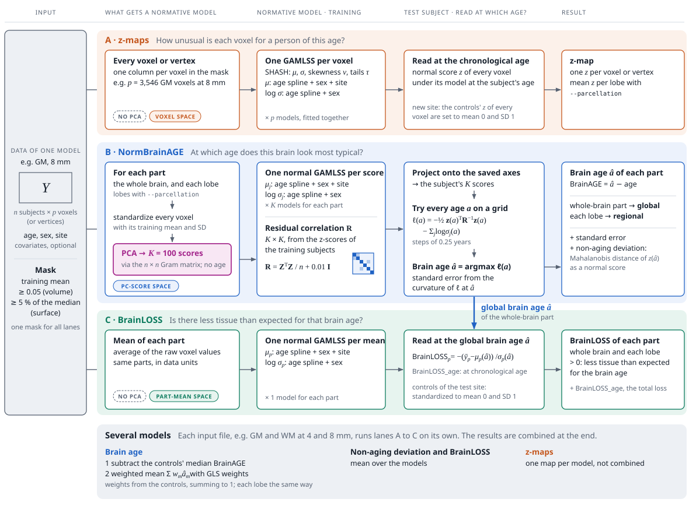
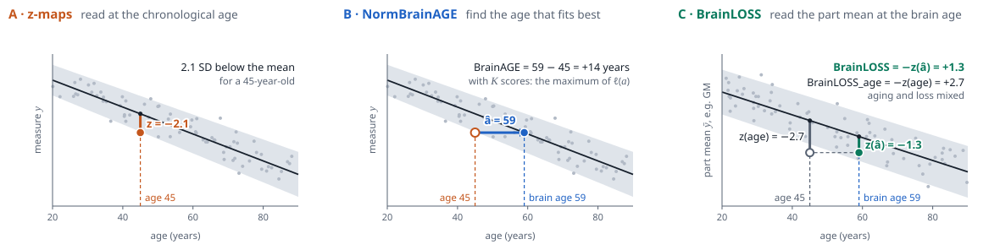
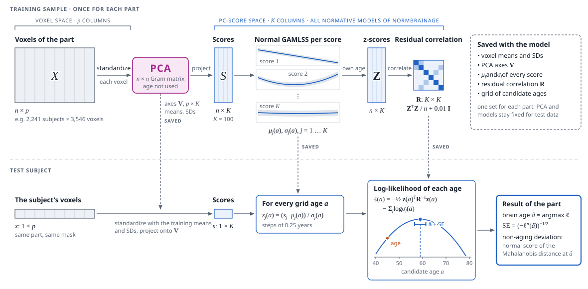
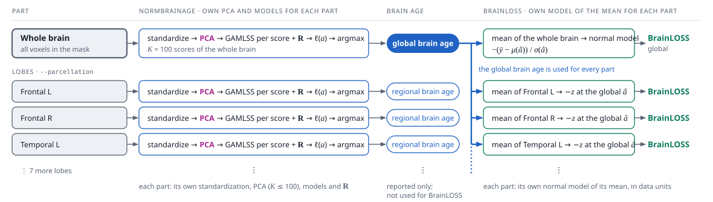

# z-maps, NormBrainAGE and BrainLOSS, step by step

NeuroGAMLSS · `neurogamlss.py`. An HTML version of this page is [NeuroGAMLSS Method Scheme.html](NeuroGAMLSS%20Method%20Scheme.html). Its figures are the source of the SVG files below, which `figures/method_scheme.py` writes.

All three results use the same building block, a GAMLSS normative model fitted separately to each column of a data matrix, with a natural spline of age plus sex, site and optional covariates. The results differ in what the columns are (voxels, principal component scores or the mean of a brain region) and in the age at which a test subject is compared with the model.

- **A · z-maps.** How unusual is each voxel for a person of this age? A normative model for every voxel or vertex, read at the chronological age.
- **B · NormBrainAGE.** At which age does this brain look most typical? Normative models of 100 principal component scores per brain part, read at every age of a grid. The most likely age is the brain age.
- **C · BrainLOSS.** Is there less tissue than expected for that brain age? A normative model of the mean of each brain part, read at the global brain age. BrainLOSS_age reads it at the chronological age.

## The three pipelines for one model

One model is one input file, such as gray matter at 8 mm. Each lane reads from left to right, and the columns line up across lanes. A column shows what the three pipelines model, where PCA enters and at which age the test subject is read.



**Figure 1.** Three pipelines for one model. Each lane fits its own normative models to the training sample. Only NormBrainAGE uses PCA, which turns the voxels of each part into $`K = 100`$ component scores, so its normative models live in the space of these scores. The z-maps model every voxel and BrainLOSS models one mean per part, both without PCA. Apart from the shared mask, the blue arrow is the only link between the lanes: it carries the global brain age from lane B to BrainLOSS. BrainLOSS_age reads the same model at the chronological age. All normative models can add covariates such as image quality measures to $`\mu`$ and $`\log \sigma`$, and `--site-sd` adds the site to $`\log \sigma`$.

## Three ways to read a normative model

The difference between the three results is easiest to see in a single normative model. A z-map reads the model at the chronological age. NormBrainAGE inverts it and looks for the age that fits the data best. BrainLOSS reads its own model at that brain age.



**Figure 2.** One normative model, read at three ages. Simulated example of a 45-year-old whose brain looks like that of a 59-year-old. The grey band is the 95% range of the training sample. **A.** At the chronological age, the value lies 2.1 SD below the mean. **B.** NormBrainAGE looks for the age at which the value is most typical, here 59 years, so BrainAGE is +14 years. With $`K`$ component scores, it is the age at which all scores together are most likely (Figure 3). **C.** BrainLOSS reads the mean of a brain part at the brain age. At the chronological age, the deficit is 2.7 SD (BrainLOSS_age = +2.7) and mixes the older-looking brain with additional loss. At the brain age, 1.3 SD remain, so BrainLOSS is +1.3.

## In plain words

**z-maps.** For every voxel, the training sample shows how much tissue people have at each age, for women and men and for each scanner. A patient's voxel is compared with people of the same age. A z-score of −2 means unusually little tissue for that age. Every voxel has its own model, and no PCA is involved.

**NormBrainAGE.** PCA first summarizes the brain, or one lobe, by 100 patterns of variation among the training subjects. Each pattern's score gets a normative model of age. For a new person, we ask the reverse question: at which age would this combination of scores be most typical? That age is the brain age. The width of the likelihood peak gives each person a standard error.

**BrainLOSS.** Once the brain age is known, we ask whether the person has less tissue than a typical person of that brain age. The mean tissue of the whole brain, or of a lobe, is compared with its normative range at the brain age. An older-looking brain explains part of a tissue deficit, and BrainLOSS is the part that it does not explain. BrainLOSS_age is the deficit compared with people of the same age, before the brain age is taken into account.

## Side by side

|  | A · z-maps | B · NormBrainAGE | C · BrainLOSS |
| --- | --- | --- | --- |
| Columns with a normative model | every voxel or vertex in the mask | $`K = 100`$ principal component scores of each part | the mean of each part |
| PCA | no | yes, for each part, on the standardized voxels | no |
| Values that enter | raw voxel values | voxels standardized with their training mean and SD | raw voxel values, averaged in data units |
| Terms of $`\mu`$ and $`\log \sigma`$ | the same for all three: $`\mu`$ is a natural spline of age plus sex, site and covariates; $`\log \sigma`$ a natural spline of age plus sex and covariates (and site with `--site-sd`) | | |
| Distribution | SHASH by default (normal and GG optional) | normal | normal |
| Link between the columns | none | residual correlation $`\mathbf{R}`$, $`K \times K`$ | none |
| Spline df of age | 5-fold CV, held-out log-likelihood of normal models of 1,000 random voxels | 5-fold CV, mean absolute error of the held-out global brain age | 5-fold CV, held-out log-likelihood |
| Test subject read at | the chronological age | every age of a grid; the most likely age is the brain age | the global brain age of the same model; `BrainLOSS_age`: the chronological age |
| Result per subject | one $`z`$ per voxel; mean $`z`$ per lobe | global and regional brain age, standard error, non-aging deviation | BrainLOSS and BrainLOSS_age of the whole brain and of each lobe |
| Controls of a new site | $`z`$ of every voxel set to mean 0 and SD 1 | their median BrainAGE is subtracted (default) | standardized to mean 0 and SD 1 |
| Several models | one map per model | weighted mean, GLS weights | mean |
| Option | `--zmaps`, `--normative-only` | default | `--brainloss` |

## z-maps: the conventional normative model

The z-maps answer the classical question of normative modeling. Every voxel or vertex has its own model, and nothing is combined across voxels before the z-scores are computed.

### Training sample

1. Keep the voxels or vertices whose mean over the training subjects reaches 0.05 (volume) or 5% of the median of all means (surface). Brain age and BrainLOSS use the same mask.
2. Fit a GAMLSS to every voxel with the SHASH distribution. Location $`\mu`$ and log scale $`\log \sigma`$ are natural splines of age plus sex, site and covariates; skewness $`\nu`$ and tail weight $`\tau`$ are constant. All voxels are fitted at once.
3. One pair of spline df serves all voxels. It is chosen by 5-fold cross-validation of the held-out log-likelihood of normal models of 1,000 random voxels.

### Test subject

4. Compute the normal score of every voxel at the chronological age, under the model of the subject's sex and covariates at the reference site, the size-weighted mean of the training sites.
5. With controls of the test site (`--adjust`), the controls' z-scores of every voxel are shifted and scaled to mean 0 and SD 1, and all test subjects get the same shift and scale. With several test sites, every site gets its own shift, the mean of its controls shrunk toward that of all controls, and all sites share one scale.
6. With `--parcellation`, the z-map is also averaged within each lobe.

In the code: `VoxelModel.fit`, `NormativeModel` with `family='shash'`, `VoxelModel.zmaps`.

## NormBrainAGE: PCA first, then normative models of the scores

NormBrainAGE does not use the voxel-wise models of the z-maps. It reduces the voxels of each part to component scores and fits its own normative models to these scores. Figure 3 follows one part through training and testing.



**Figure 3.** NormBrainAGE for one part. PCA is the boundary between voxel space and the space of the component scores, and all normative models of NormBrainAGE live in the second. Dashed lines connect what is estimated once in the training sample and saved with the model to the step where a test subject uses it. The PCA does not use age; age enters only through the normative models of the scores.

### Training sample, for every part

1. Take the masked voxels of the part and standardize each one with its training mean and SD, so that all enter the PCA with unit variance.
2. Compute the PCA from the $`n \times n`$ Gram matrix of the $`n`$ training subjects and keep $`K = 100`$ components (fewer if the part has fewer voxels or subjects). The PCA does not see age.
3. The $`K`$ component scores are the features. Each gets a normal GAMLSS whose $`\mu_j(a)`$ and $`\log \sigma_j(a)`$ are natural splines of age plus sex, site and covariates.
4. The z-scores of the training subjects at their own age give the residual correlation, a $`K \times K`$ matrix:

```math
\mathbf{R} = \frac{1}{n} \sum_i \mathbf{z}_i \mathbf{z}_i^\top + 0.01\, \mathbf{I}
```

5. One pair of spline df serves all scores and parts. It is chosen by 5-fold cross-validation of the mean absolute error of the held-out global brain age.

### Test subject

6. Standardize the subject's voxels with the training means and SDs and project them onto the saved axes. This gives the subject's $`K`$ scores $`s_j`$.
7. For every age $`a`$ of a grid, in steps of 0.25 years from 5 years below the youngest to 5 years above the oldest training subject (not below 0), compute $`z_j(a) = (s_j - \mu_j(a)) / \sigma_j(a)`$ and the log-likelihood below. It uses the model of the subject's sex at the reference site, with the subject's own covariates.

```math
\ell(a) = -\tfrac{1}{2}\, \mathbf{z}(a)^\top \mathbf{R}^{-1} \mathbf{z}(a) - \sum_j \log \sigma_j(a)
```

8. The brain age $`\hat a`$ is the maximum of $`\ell`$, refined by a parabola through the grid maximum and its neighbours. The curvature gives the standard error, $`\mathrm{SE} = (-\ell''(\hat a))^{-1/2}`$. BrainAGE is $`\hat a`$ minus the chronological age. Estimates at the end of the grid are flagged.
9. The non-aging deviation is the Mahalanobis distance $`d^2 = \mathbf{z}(\hat a)^\top \mathbf{R}^{-1} \mathbf{z}(\hat a)`$, turned into a normal score with the Wilson–Hilferty approximation of $`\chi^2`$ with $`K`$ df. The same distance at the chronological age gives the total deviation.

PCA scores are uncorrelated in the training sample. Their z-scores are correlated, because removing age, sex and site and dividing by an age-dependent SD changes them differently. $`\mathbf{R}`$ carries this correlation into the likelihood.

In the code: `NDMBrainAge._fit_pca_part`, `_pca`, `ResidualCorrelation`, `_loglik_grid`, `_argmax_refine`, `_mahalanobis`, `deviation_z`.

## Global and regional brain age, and the age BrainLOSS uses

With `--parcellation`, every lobe of the atlas becomes a part of its own, next to the whole brain. Volume data have 10 lobes (frontal, parietal, occipital, temporal and subcortical/cerebellar, left and right). Surfaces have 8, because the subcortical/cerebellar regions are not on the surface.



**Figure 4.** Parts of one model. Every part runs the pipeline of Figure 3 on its own voxels. The whole-brain part gives the global brain age, so the global brain age is not an average of the lobe ages. BrainLOSS of every part, the lobes included, is read at this global brain age. The regional brain ages are reported but do not enter BrainLOSS.

### BrainLOSS, training sample, for every part

1. Average the part's voxels for every subject. The mean $`\bar y_p`$ is in the units of the data: raw values, not standardized, without PCA and before any warp.
2. Fit a normal GAMLSS of $`\bar y_p`$ with the same terms as the other models. Its spline df are chosen by 5-fold cross-validation of the held-out log-likelihood.

### BrainLOSS, test subject

3. Read the model at the global brain age $`\hat a`$ of the same model (input file), at the reference site:

```math
\mathrm{BrainLOSS}_p = -\frac{\bar y_p - \mu_p(\hat a)}{\sigma_p(\hat a)}
```

4. Read it also at the chronological age $`a`$, for subjects with a known age:

```math
\mathrm{BrainLOSS}^{\mathrm{age}}_p = -\frac{\bar y_p - \mu_p(a)}{\sigma_p(a)}
```

5. With controls of the test site, standardize both scores of every part to mean 0 and SD 1 in the controls. With several test sites, every site gets its own shift as in the z-maps.
6. Positive values mean less tissue than expected for the brain age (BrainLOSS) or for the chronological age (BrainLOSS_age).

Step 3 uses the brain age as estimated, before the site correction of BrainAGE. The standardization with the controls in step 5 then removes a shift that is common to the test site.

### Why the brain age, and what BrainLOSS_age adds

The two scores differ by the part of the tissue deficit that the brain age explains. Before the standardization, and exactly for a linear age curve with a constant SD,

```math
\mathrm{BrainLOSS}^{\mathrm{age}}_p = \mathrm{BrainLOSS}_p + b_p\, \mathrm{BrainAGE}, \qquad b_p = -\frac{\mu_p'}{\sigma_p}
```

Here $`b_p`$ is the normative decline of the part mean per year, in SD units. In Figure 2, the 45-year-old whose brain looks 59 has 2.7 SD less tissue than 45-year-olds. About 1.4 SD of that is what any 59-year-old brain has, and BrainAGE = +14 already reports it. BrainLOSS is the 1.3 SD that remain.

BrainLOSS_age therefore overlaps with BrainAGE, while BrainLOSS hardly does. In the MCI patients of ADNI (gray matter), the Spearman correlation of BrainLOSS with BrainAGE was −0.01 for the whole brain and 0.14 for the temporal lobes. In a model that also contains BrainAGE, the two scores carry nearly the same information. On its own, BrainLOSS shows whether there is less tissue than expected for the brain age, and BrainLOSS_age whether there is less tissue than in people of the same age.

In the code: `NDMBrainAge.fit` (the parts), `_part_means`, `_fit_loss`, `_loss`; the standardization is in `apply_models`.

## Several models: the ensemble

Files given separately on the command line, such as `gm.mat wm.mat`, are separate models of the same subjects. Each runs Figures 3 and 4 on its own, and only their results are combined.

|  | Each model $`m`$ | → Controls of the test site | → Across the models | → Field of `NDM` in `<out>.mat` |
| --- | --- | --- | --- | --- |
| Brain age | $`\hat a_m`$ of the whole brain and of each lobe | subtract their median BrainAGE, separately for the whole brain and each lobe (default `--correction offset`) | weighted mean $`\sum_m w_m \hat a_m`$ with GLS weights; each lobe with its own weights | `BrainAGE_ensemble`, `BrainAGE_regional_ensemble` |
| Non-aging deviation | normal score of each model | unchanged | mean | `Deviation_ensemble` |
| BrainLOSS | whole brain and each lobe, at $`\hat a_m`$; BrainLOSS_age at the chronological age | both standardized to mean 0 and SD 1 | mean | `BrainLOSS_ensemble`, `BrainLOSS_regional_ensemble`, `BrainLOSS_age_ensemble`, `BrainLOSS_age_regional_ensemble` |
| z-maps | one map per model | $`z`$ of every voxel set to mean 0 and SD 1 | not combined | `<out>_zmaps_<model>.mat` |

With several test sites, the column of the controls applies to every site with its own controls: the median BrainAGE of the site's controls is subtracted, and BrainLOSS and the z-maps get the offset of the site, shrunk toward the mean of all controls, and a scale common to all sites. The sites are written to `site` and `site_names`.

The GLS weights minimize the mean squared error of the combined brain age, under the constraint that they sum to one:

```math
\mathbf{w} = \frac{\mathbf{C}^{-1} \mathbf{1}}{\mathbf{1}^\top \mathbf{C}^{-1} \mathbf{1}}, \qquad C_{mm'} = \frac{1}{n_c} \sum_i e_{im}\, e_{im'}
```

Here $`e_{im}`$ is the BrainAGE of control $`i`$ in model $`m`$. The weights account for the correlation of the errors between models and can be negative. They come from the controls given with `--adjust`. Without controls, all test subjects with a known age are used, and with `--kfold` all subjects.

In the code: `correct_age`, `ensemble_weights`, `_combine`, `_summarize`.

## Options that change the picture

- `--pca 0`: NormBrainAGE models every voxel instead of component scores, with a low-rank plus diagonal $`\mathbf{R}`$ of rank 20. With `--family normal`, this voxel-wise model is shared with the z-maps.
- `--warp`: an age-independent sinh-arcsinh transform of every voxel before the standardization and the PCA. It is off by default. BrainLOSS uses the values before the warp.
- `--no-standardize`: PCA of the raw voxel values instead of standardized ones.
- `--site-sd`: the training sites also enter $`\log \sigma`$ of all normative models.
- `--train-cov`, `--test-cov`: covariates such as image quality measures enter $`\mu`$ and $`\log \sigma`$ of all normative models, and every subject is read at its own values.
- `--test-nuisance`: nuisance effects are estimated in the controls and removed from the test data before brain age and BrainLOSS, and from the z-scores of the z-maps.
- `--test-site`: the sites of a test sample from several scanners, as `+`-joined test files are. Every site is adapted with its own controls: shrunk shifts for the z-maps, the component scores (`adapt`, `agefree`) and BrainLOSS, and the median BrainAGE of its controls.
- `--correction`: `adapt` rescales the normative models of the scores with the controls instead of subtracting an offset, `agefree` does so at the controls' estimated brain ages and then subtracts their median BrainAGE, `trend` removes a linear trend of BrainAGE on age, and `none` only estimates the ensemble weights.

Built from `neurogamlss.py`, `NDM_methods.md` and `docs/models.md` as of 16 October 2026. Defaults shown: `--pca 100`, `--psi-min 0.01`, `--grid-step 0.25`, `--grid-margin 5`, `--df-mu auto`, `--df-sigma auto`, `--correction offset`, `--ensemble gls`, and `--family shash` for the z-maps. Figure 2 uses simulated values.
